# 7v7 — Halı Saha

7 kişilik halı saha kadronu kurduğun, dizilişi seçip yelekleri sahaya dağıttığın, sahayı ve saati ayarlayıp maçı kaydettiğin; arkadaşlarını boş bir mevkiye **maça davet edip** onlarla sohbet ettiğin mobil uygulama. Flutter ile yazılmıştır; hesaplar ve veriler Firebase'de (Authentication + Cloud Firestore, ücretsiz Spark planı) tutulur, kullanıcılar arası tüm işlemler istemcide batch/transaction ile yapılıp güvenlik kurallarıyla korunur.

| Takım Kur | Diziliş Seç | Maç Saati |
| --- | --- | --- |
| 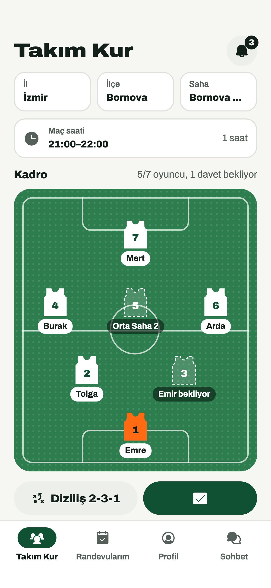 | 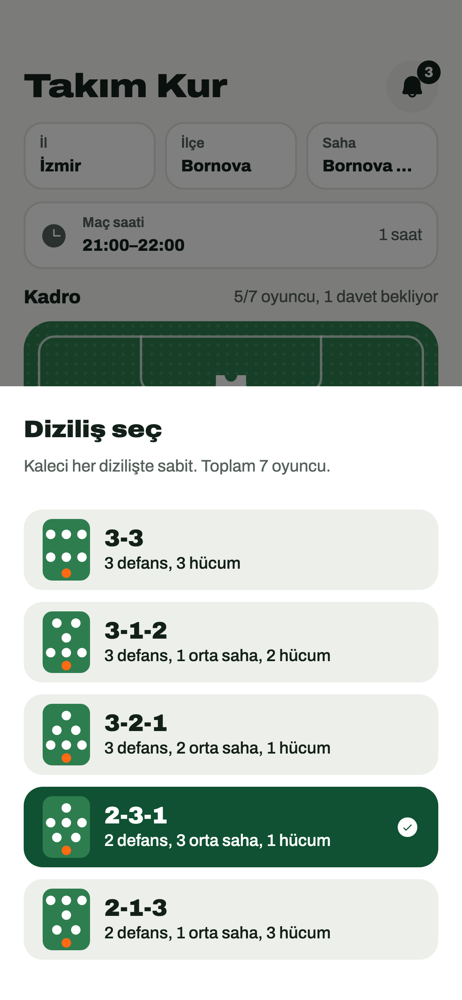 | 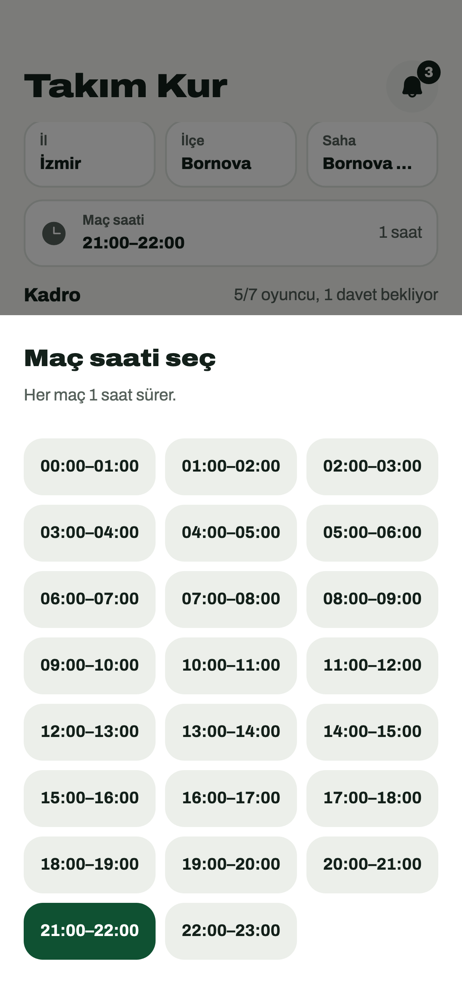 |

| Randevularım | Randevu Detay | Davetli Olduğun Maç |
| --- | --- | --- |
| 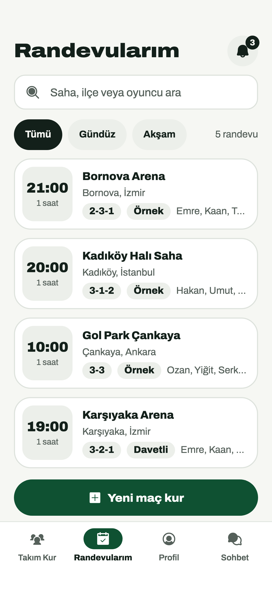 | 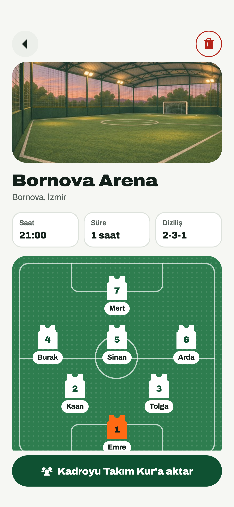 | 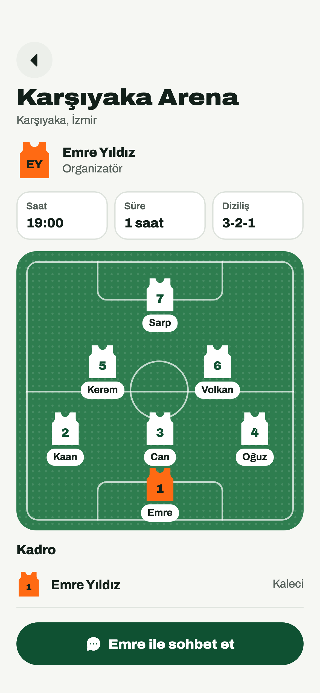 |

| Arkadaş Ekle | Maça Davet Et | Maç Daveti |
| --- | --- | --- |
| 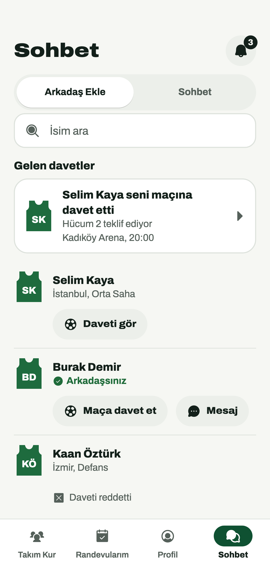 | 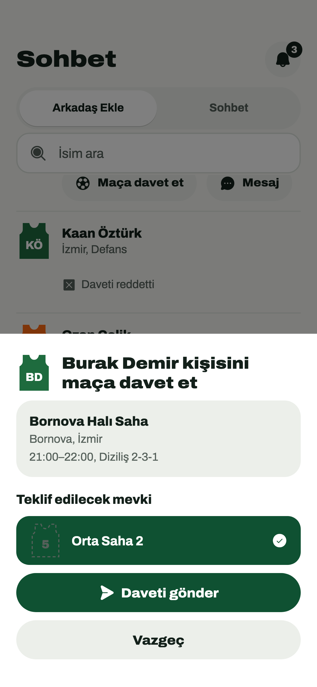 | 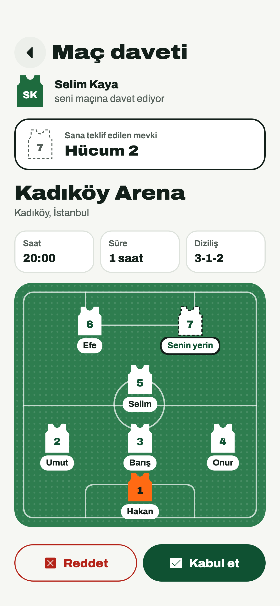 |

| Sohbet | Bildirimler | Profil |
| --- | --- | --- |
| 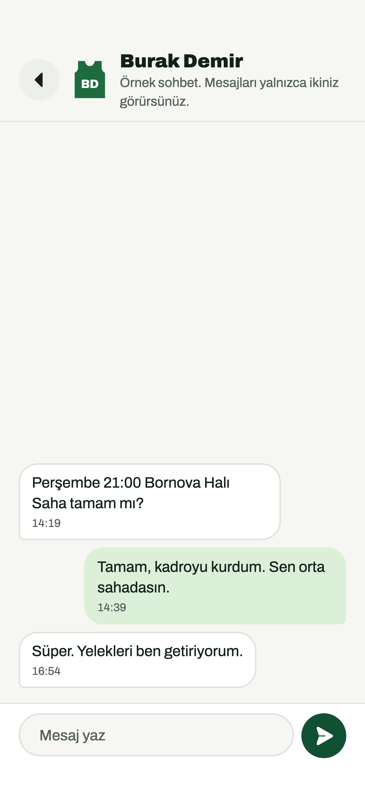 | 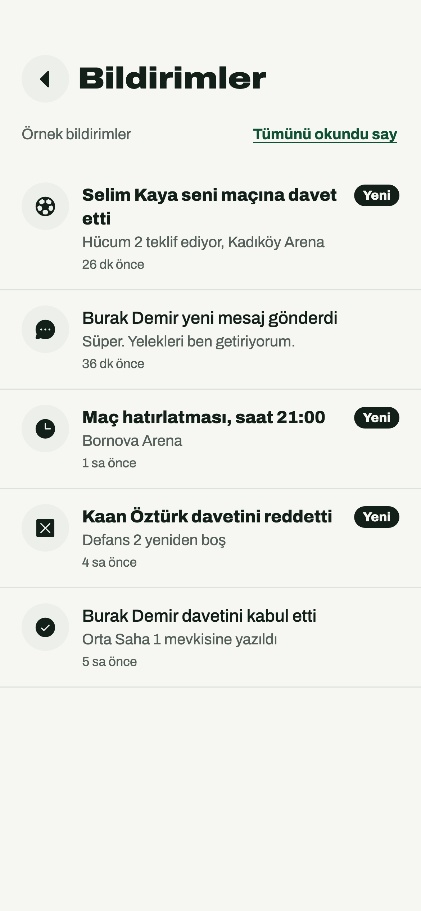 | 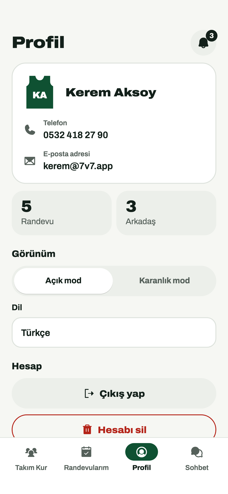 |

| Karanlık Mod | Hesabı Sil | İngilizce |
| --- | --- | --- |
| 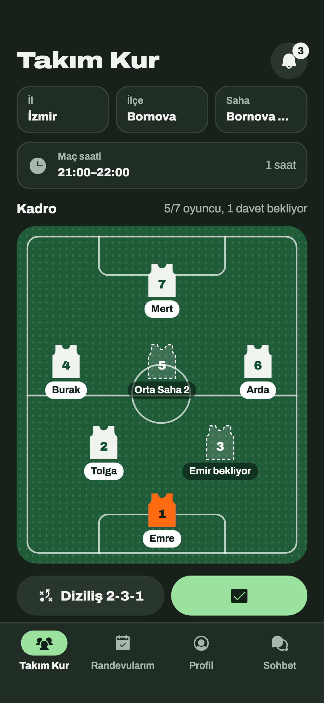 | 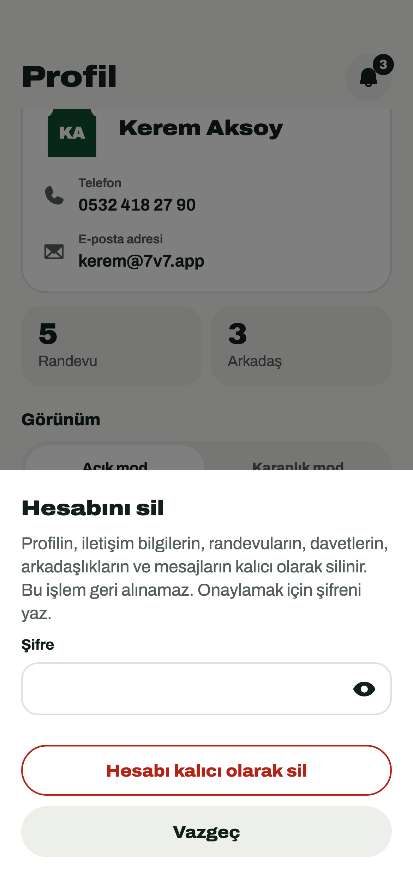 | 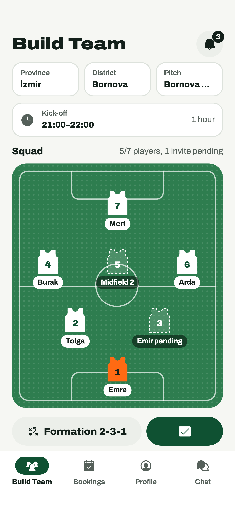 |

Ek görüntüler: [Hoş geldin](docs/screenshots/01-welcome.png) · [Giriş](docs/screenshots/02-signin.png) · [Kayıt](docs/screenshots/03-signup.png) · [Şifremi unuttum](docs/screenshots/04-forgot-password.png) · [Oyuncu ekle](docs/screenshots/07-player-sheet.png) · [Sohbetler](docs/screenshots/15-chats.png) · [Randevularım (karanlık)](docs/screenshots/21-appointments-dark.png) · [Sohbet (karanlık)](docs/screenshots/22-chat-dark.png) · [Boş randevu listesi](docs/screenshots/24-appointments-empty.png)

## Özellikler

- Kayıt / giriş: ad, soyad, e-posta, telefon (`05XX XXX XX XX`, tekil), en az 8 karakterli şifre; Kullanıcı Sözleşmesi ve KVKK Aydınlatma Metni onayı. Giriş e-posta + şifreyle, "Şifremi unuttum" e-postayla yenileme bağlantısı gönderir
- **Takım Kur:** 5 diziliş (3-3, 3-1-2, 3-2-1, 2-3-1, 2-1-3), kaleci her dizilişte sabit; sahada yeleğe dokunarak oyuncu adı yazma, aynı oyuncunun iki mevkiye yazılmasını engelleme, diziliş değişince açıkta kalan oyuncuların boş mevkilere taşınması
- 81 il, ilçe ve örnek saha seçimi; 1 saatlik maç saati; eksik bilgi kontrolü ve "Maçı kaydet". Taslak her değişiklikte otomatik kaydedilir
- **Randevularım:** kurduğun ve davetli olduğun maçlar ("Davetli" etiketi), saha / ilçe / il / oyuncu adına göre arama, Gündüz–Akşam filtresi; detayda saha, kadro, maçı yeniden kullanma, silme ve geri alma
- **Maça davet et:** kullanıcıları ara, kurduğun maçın bilgileriyle boş bir mevkiyi teklif et. Alıcı daveti görür, kabul ederse adı teklif edilen mevkiye yazılır ve arkadaş olursunuz; reddederse arkadaş olmayan kişiye yeniden davet gönderilemez. Bekleyen davet geri çekilebilir
- **Sohbet:** yalnızca arkadaşlarla birebir mesajlaşma, sohbet listesinde son mesaj önizlemesi ve saati
- **Bildirimler:** maç daveti, kabul / ret, maç kaydedildi ve yeni mesaj bildirimleri; tümünü okundu işaretleme
- **Profil:** iletişim bilgileri, randevu ve arkadaş sayısı, açık / karanlık mod, Türkçe / İngilizce, çıkış
- **Hesabı sil (App Store 5.1.1(v), KVKK):** şifreyle onaylanır; profil, iletişim bilgileri, randevular, davetler, arkadaşlıklar, sohbetler, mesajlar ve başkalarına bırakılan bildirimler dahil tüm veriler ve Firebase hesabı kalıcı olarak silinir. Yarıda kalırsa yeniden denendiğinde kaldığı yerden tamamlanır
- **Kişisel veri gizliliği:** e-posta ve telefon yalnızca sahibinin okuyabildiği ayrı bir belgede tutulur; diğer kullanıcılar yalnızca ad, şehir ve mevkiyi görür. Telefon tekilliği okunamayan bir dizinle sağlanır (telefon numarasından kişiye ulaşılamaz)
- Erişilebilirlik: butonlar en az 44 px yükseklikte, ekran okuyucu etiketleri; 360×640 küçük ekranlarda ve İngilizce metinlerde taşmasız düzen (testlerle denetlenir)

## Kurulum ve çalıştırma

Firebase yapılandırma dosyaları (`lib/firebase_options.dart`, `ios/Runner/GoogleService-Info.plist`, `android/app/google-services.json`, `.firebaserc`) depoda yoktur; önce kendi Firebase projen için üret:

```bash
dart pub global activate flutterfire_cli
firebase use --add                     # .firebaserc
flutterfire configure --platforms=ios,android --ios-bundle-id=com.sevenv7 --android-package-name=com.sevenv7
firebase deploy --only firestore,auth  # kurallar, indeksler, e-posta/şifre girişi
```

Ardından:

```bash
flutter pub get
flutter gen-l10n
flutter analyze
flutter test
flutter run            # bağlı cihaz / simülatör, canlı Firebase projesi
```

Firebase Emulator Suite ile (Auth 9099, Firestore 8080, arayüz 4000) örnek veriyle geliştirmek için:

```bash
firebase emulators:start
cd test/emulator_seed && npm i && \
  FIRESTORE_EMULATOR_HOST=127.0.0.1:8080 FIREBASE_AUTH_EMULATOR_HOST=127.0.0.1:9099 \
  FIREBASE_PROJECT_ID=<proje-id> node seed.js
flutter run --dart-define=USE_EMULATORS=true
```

> Not: Örnek veri betiği yalnızca emülatörde çalışır; canlı projeye yazmayı reddeder. Emülatörler Java ister (Android Studio ile gelen JBR yeterlidir). iOS en düşük sürümü 15.0'dır.

Testler:

```bash
# Güvenlik kuralları (emülatörde)
firebase emulators:exec --only firestore --project demo-7v7-rules "cd test/rules && npm i && npm test"

# Uçtan uca davet akışı (emülatör + örnek veri, simülatörde)
flutter test integration_test/invite_flow_test.dart -d <simülatör>

# Canlı proje: arayüzle kayıt, giriş, davet/maç/mesaj, gizlilik ve hesap silme;
# açtığı test hesaplarını uygulamanın kendi silme akışıyla temizler
flutter test integration_test/live_e2e_test.dart -d <simülatör> --dart-define=LIVE_E2E=true
```

Ekran görüntüleri ve golden testler yeniden üretilirse:

```bash
flutter test test/screenshots_test.dart --update-goldens --dart-define=SCREENSHOTS=true
flutter test test/goldens_test.dart --update-goldens
```

## Mimari

Feature bazlı klasörler (`lib/features/<özellik>/` altında ekranlar ve `widgets/`); ortak bileşenler `lib/core/widgets`, yardımcılar `lib/core/utils`, veri modelleri `lib/models`. State Riverpod (`flutter_riverpod`) ile yönetilir; ekranlar Firestore'a doğrudan değil `lib/services` altındaki servisler (`AuthService`, `AccountService`, `DraftService`, `AppointmentService`, `InviteService`, `ChatService`, `NotificationService`, `UserService`) üzerinden erişir. Navigasyon `go_router` (`StatefulShellRoute` ile 4 sekme), çeviriler `gen-l10n` ARB dosyaları (`lib/l10n`), ikonlar Phosphor, yazı tipi Archivo.

Firestore koleksiyonları: `users` (herkese açık profil) + `users/{uid}/private/contact` (yalnızca sahibi) + `users/{uid}/notifications`, `phoneIndex`, `drafts`, `appointments`, `invites`, `inviteLocks`, `friendships`, `chats/{id}/messages`. Her yazma [firestore.rules](firestore.rules) ile doğrulanır.

## Notlar

- Ücretsiz Spark planında Cloud Functions yoktur: davet yanıtı, arkadaşlık, bildirim üretme, randevuya üye ekleme ve hesap silme istemcide tek batch/transaction'larla yapılır; güvenlik kuralları her adımı tek tek doğrular.
- Ekran görüntüleri gerçek ekranlardan, örnek veriyle (`test/emulator_seed/firestore_seed.json`) üretilmiştir; uygulamada demo hesabı veya hazır veri yoktur.
- iOS simülatörü yalnızca debug derlemesini çalıştırır; mağaza (release) derlemesi gerçek cihazda denenmelidir.
- Firestore veritabanı `nam5` (ABD) bölgesindedir.
