# Kitalog

Kitaplarını, okuma durumunu, alıntılarını, notlarını ve yıllık okuma hedefini takip ettiğin; telifi bitmiş kitapları uygulama içinde **çevrimdışı okuyabildiğin** kişisel sanal kütüphane. Flutter ile yazılmıştır; veriler cihazda (`shared_preferences`), indirilen kitap metinleri uygulama klasöründe dosya olarak saklanır.

| Kitaplığım | Okuma Durumu | Yıllık Hedef |
| --- | --- | --- |
| 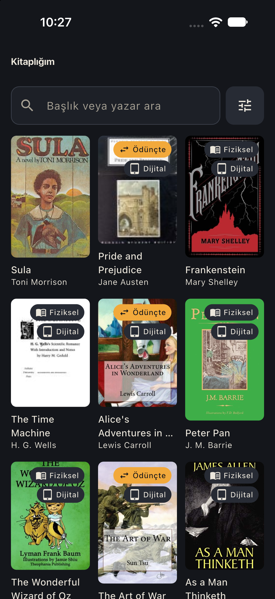 | 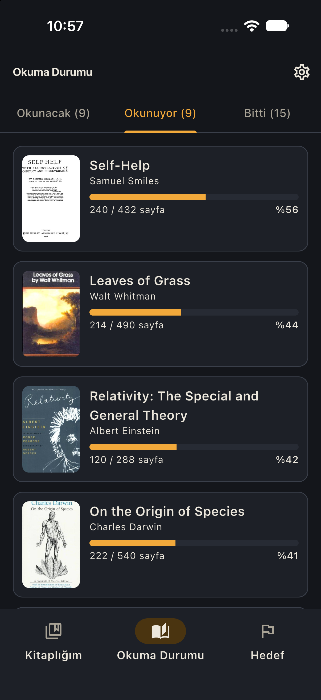 | 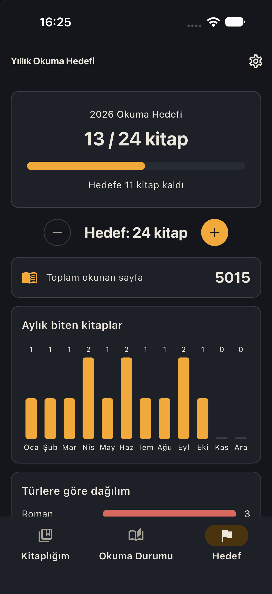 |

| Kitap Detay | Yeni Kitap Ekle | Ayarlar |
| --- | --- | --- |
| 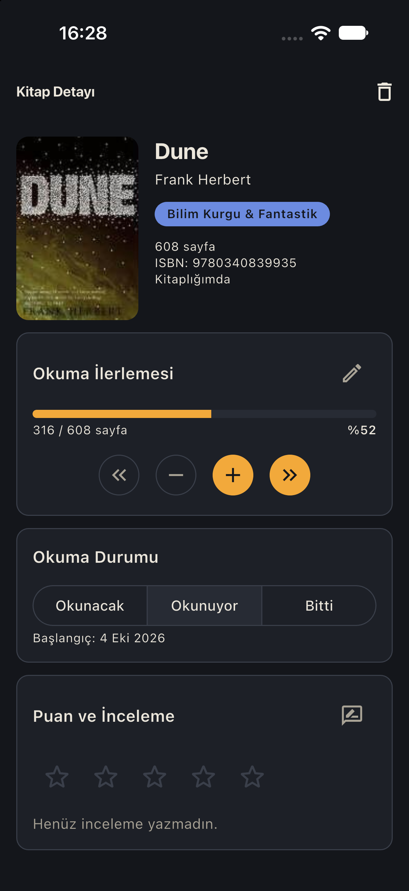 | 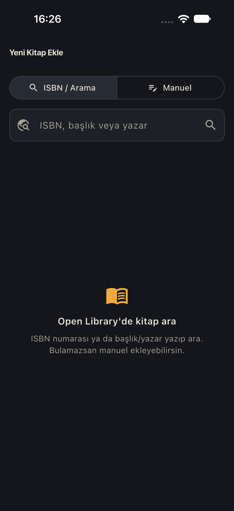 | 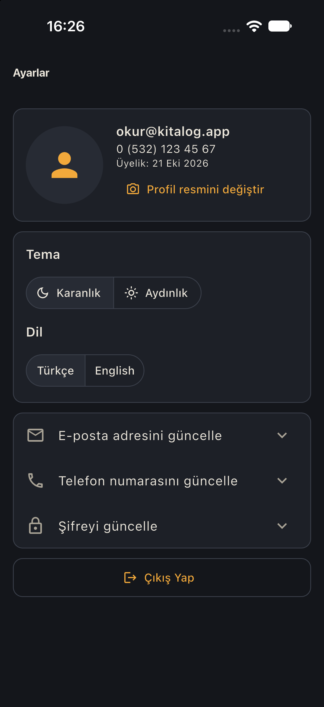 |

| Dijital Okuyucu | Çevrimdışı Okuma | Dijital Sürüm |
| --- | --- | --- |
| 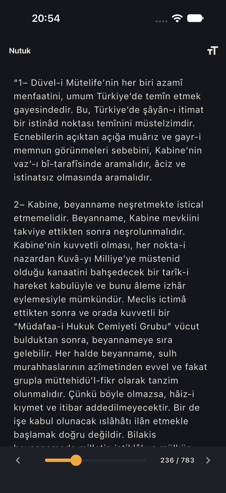 | 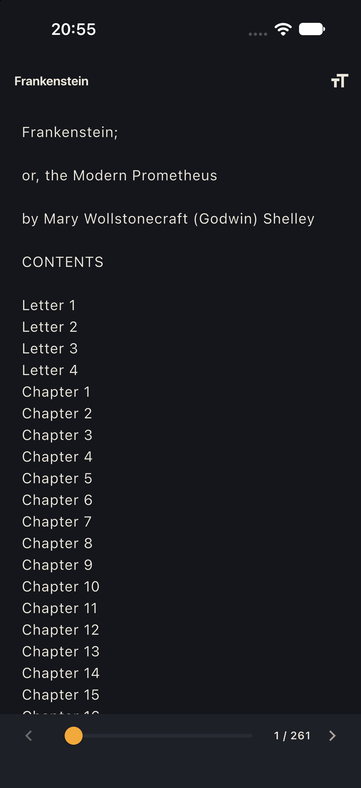 | 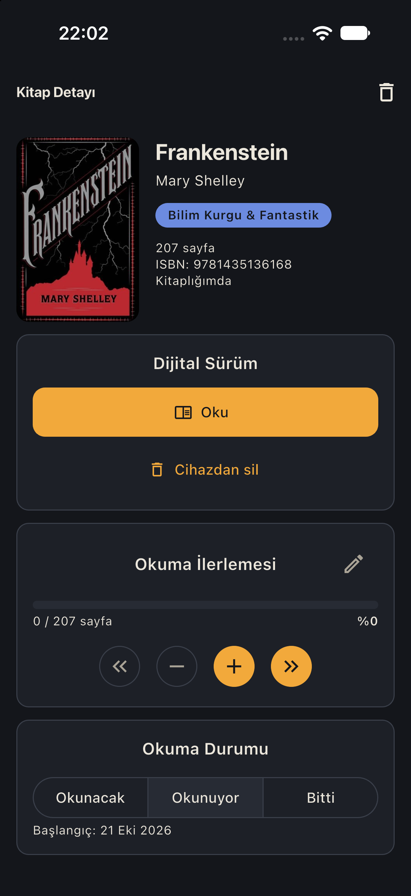 |

| Kendi PDF'in | Kendi EPUB'ın | Dosya Yükleme |
| --- | --- | --- |
| 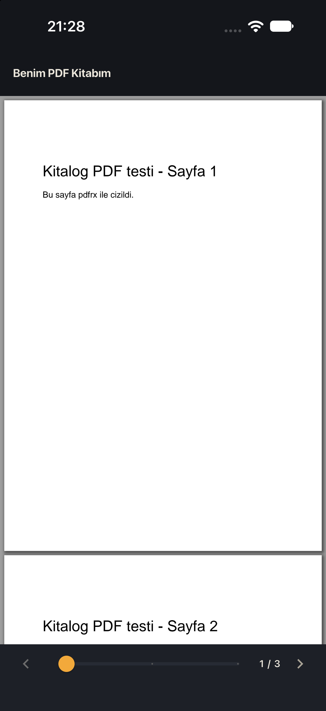 | 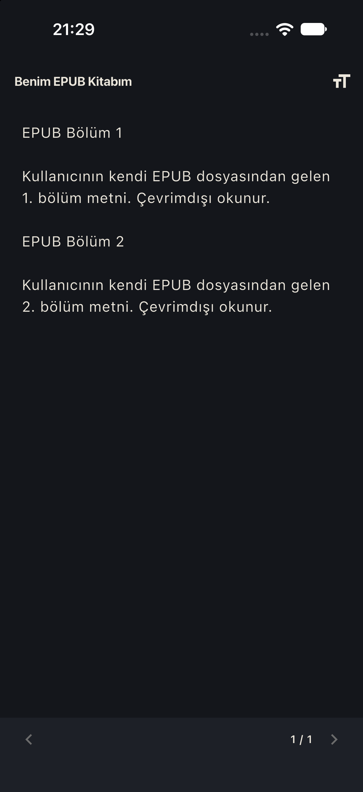 | 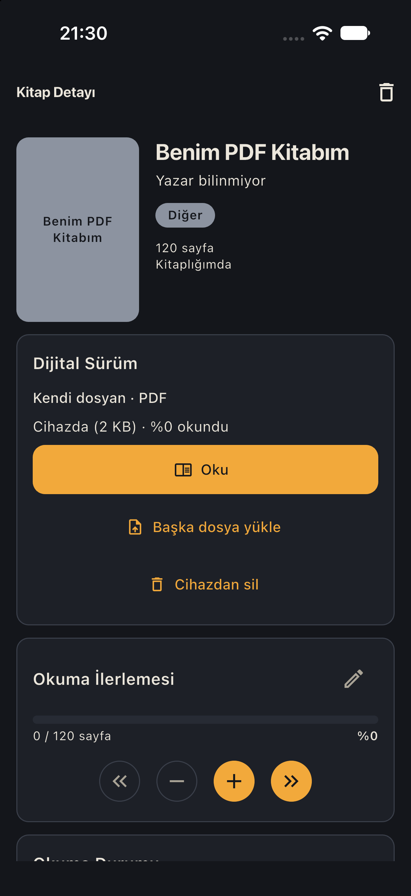 |

Ek görüntüler: [Bildirim ayarı](docs/screenshots/25-settings-reading-reminders.png) · [Okuma bildirimi](docs/screenshots/26-reading-reminder-notification.png) · [Ödünç Takibi](docs/screenshots/21-loans.png) · [Ödünç geçmişi](docs/screenshots/22-loan-history.png) · [Ödünç verilecek kitabı seç](docs/screenshots/23-lend-book-sheet.png) · [Okuyucuda çeviri (alt alta)](docs/screenshots/19-reader-translation.png) · [Seçili metni çevir](docs/screenshots/20-translation-sheet.png) · [Kitaplığım filtreleri](docs/screenshots/16-library-filters.png) · [Kitabı bitirdin mi?](docs/screenshots/17-finish-dialog.png) · [Şifremi unuttum](docs/screenshots/18-forgot-password.png) · [Giriş / Kayıt](docs/screenshots/01-register.png) · [Aydınlık tema](docs/screenshots/03-library-light.png) · [İngilizce](docs/screenshots/09-goal-en.png)

## Özellikler

- Kayıt / giriş (e-posta, maskeli telefon `0 (5XX) XXX XX XX`, güçlü şifre; şifre SHA-256 özeti olarak saklanır)
- Raf görünümünde kitaplık, biçim/tür filtresi, başlık-yazar araması, Fiziksel / Ödünçte / Dijital rozetleri
- Ödünç Takibi sekmesi: ödünçteki fiziksel kitaplar (gecikme / yaklaşan iade uyarısı, sekmede gecikme rozeti), buradan ödünç verme, düzenleme, iade alma ve iade geçmişi
- İade hatırlatması: iade gününden bir gün önce ve iade günü saat 10:00'da telefon bildirimi (Android / iOS, internetsiz); bildirime dokununca kitabın detayı açılır, Ayarlar'dan kapatılabilir
- Okuma hatırlatmaları (Ayarlar'dan açılır, varsayılan kapalı): her gün seçilen saatte (varsayılan 21:00) okunan kitaba göre kişisel okuma daveti; o gün okuduysan gelmez, art arda okunan günlerde seriyi hatırlatır. "Okunuyor" bir kitapta 14 gün ilerleme olmazsa bir kez "Yarım kalan kitap" hatırlatması. Dokununca dijital sürümü varsa Okuyucu, yoksa Kitap Detay açılır
- Kitap detayı: sayfa sayacı, ilerleme, puan, inceleme, alıntılar (favori), notlar, ödünç bilgisi
- Okunacak / Okunuyor / Bitti sekmeleri; okunan kitaplarda ilerleme çubuğu ve yüzde
- Open Library ile ISBN / başlık araması veya manuel ekleme
- Yıllık okuma hedefi, aylık ve türe göre dağılım
- **Dijital okuma:** telifi bitmiş kitaplar Project Gutenberg (dünya klasikleri) ve Vikikaynak'tan (Türkçe eserler) indirilip internetsiz okunur; sayfalı okuyucu, yazı boyutu, kalınan yerden devam, ilerlemenin sayfa sayacına ve yıllık hedefe otomatik yansıması
- **Okuyucuda çeviri (İngilizce ↔ Türkçe):** İngilizce kitaplar Türkçeye, Türkçe kitaplar İngilizceye cihazında (Android'de Google ML Kit, iPhone'da Apple Translation) çevrilir. Üst çubuktaki menüden orijinal, çeviri veya ikisi alt alta görünür; seçtiğin metni "Çevir" ile alttan açılan pencerede çevirip kopyalayabilir ya da alıntı olarak kaydedebilirsin. Dil paketi bir kez indirilir (iPhone'da indirmeyi sistem sorar), sonra çeviri internetsiz çalışır; çevrilen sayfalar cihazda saklanır. Yüklediğin PDF / EPUB'un dili otomatik tanınır
- **Kendi PDF / EPUB dosyan:** kendi eklediğin kitaplara cihazından PDF veya EPUB yükleyip okuyabilirsin; EPUB okuyucuda metin olarak (yazı boyutu, kalınan yer), PDF orijinal sayfalarıyla açılır. Dosya yalnızca cihazında saklanır; kopya korumalı (DRM) dosyalar desteklenmez
- Koyu ("Gece Kütüphanesi") ve aydınlık ("Kağıt") tema, Türkçe / İngilizce
- İlk açılışta 31 telifi bitmiş, dijital okunabilir kitaplık örnek veri (doğrulanmış ISBN, kapak, Gutenberg/Vikikaynak kaynağı ve metinde doğrulanmış alıntılar)

## Kurulum ve çalıştırma

```bash
flutter pub get
flutter gen-l10n
flutter analyze
flutter test
flutter run            # bağlı cihaz / emülatör
```

> Not: Uygulama Android emülatöründe, iOS simülatöründe ve gerçek cihazlarda çalışır. Apple cihaz üstü çeviriyi simülatörde kapattığı için iOS simülatöründe okuyucudaki çeviri menüsü görünmez; çeviriyi denemek için Android emülatörü veya gerçek bir iPhone kullan. iOS en düşük sürümü 18.0'dır.

İkon veya açılış ekranı dosyaları değişirse:

```bash
dart run flutter_launcher_icons
dart run flutter_native_splash:create
```

## Mimari

Feature bazlı klasörler (`controllers/`, `models/`, `views/`, `widgets/`); state `ValueNotifier` + `ValueListenableBuilder`, bağımlılıklar çekirdek `InheritedWidget` tabanlı `AppScope` ile paylaşılır. Harici state/DI/router paketi yoktur. Ayrıntılar: [PROJECT.md](PROJECT.md), [.agents/skills/SKILL.md](.agents/skills/SKILL.md). Geliştirme günlüğü ve kararlar: [DONE.md](DONE.md).

## Notlar

- Kapak ve arama verisi [Open Library](https://openlibrary.org) API'sinden gelir; internet yoksa kapaklar tür renginde başlıklı yer tutucuya düşer.
- Kitap metinleri [Project Gutenberg](https://www.gutenberg.org) ve [Vikikaynak](https://tr.wikisource.org) kaynaklıdır (telifi bitmiş eserler; uygulama kaynak atfını gösterir). Vikikaynak isteklerinde Wikimedia'nın istek sınırlarına uyulur. Kaynağından indirilmesi çok uzun süren Nutuk (~109 istek) uygulamayla birlikte paketlenir (`assets/books/`); internetsiz de anında açılır. Web sürümünde metinler yalnızca oturum boyunca saklanır.
- iOS'ta galeri/kamera izin metinleri `ios/Runner/Info.plist` içindedir.
