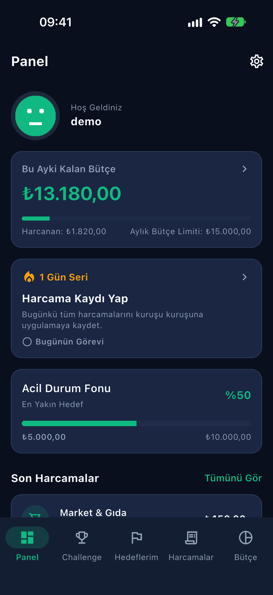
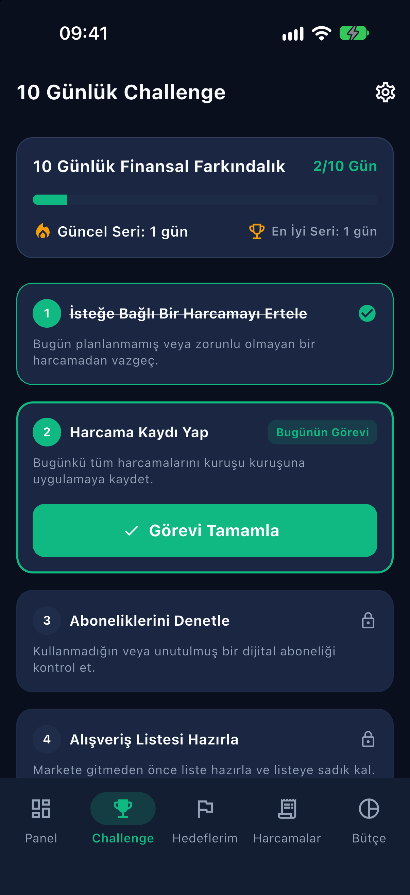
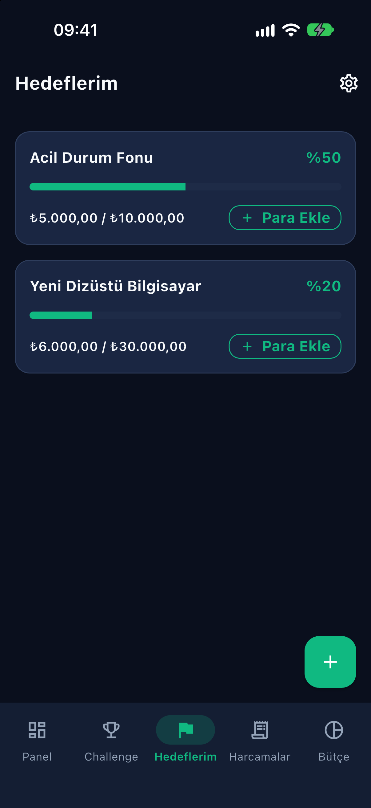
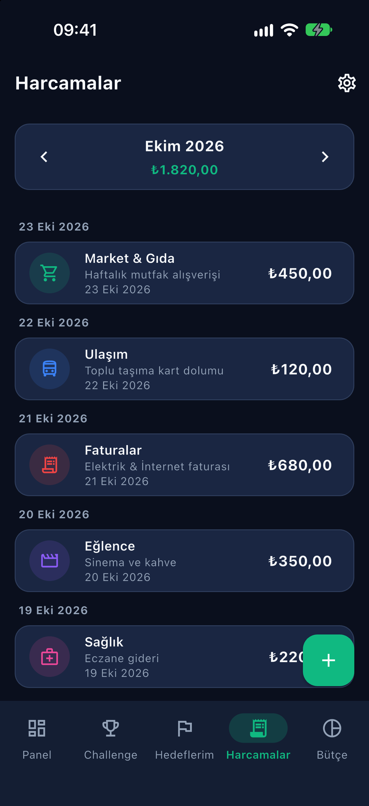
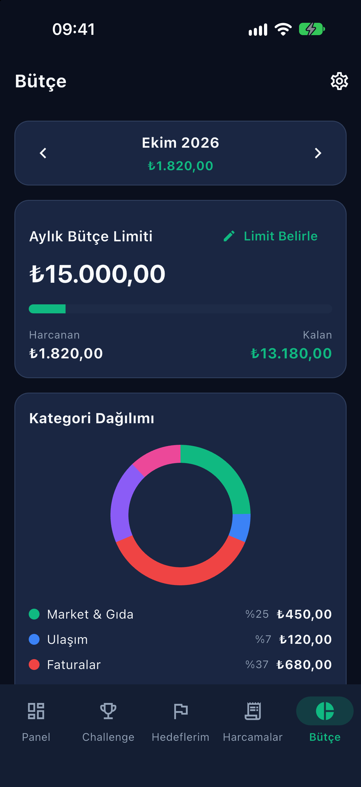
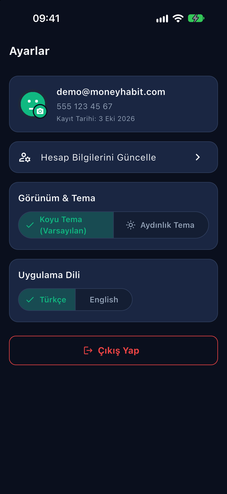
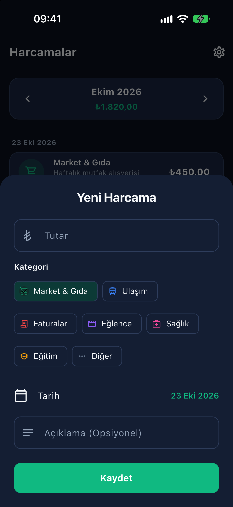
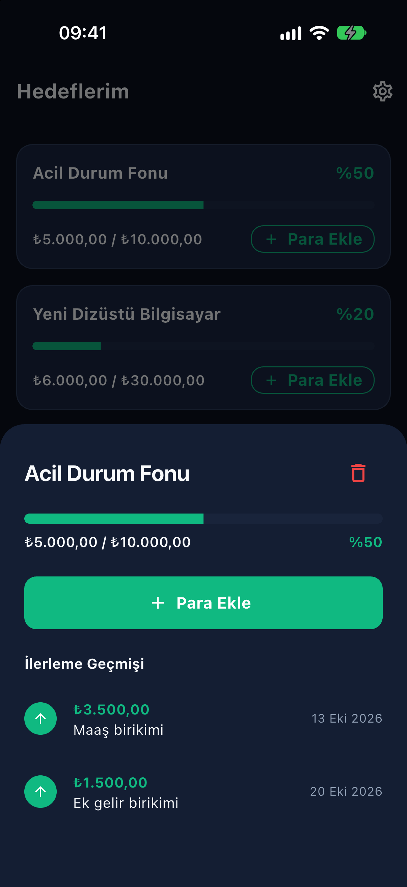
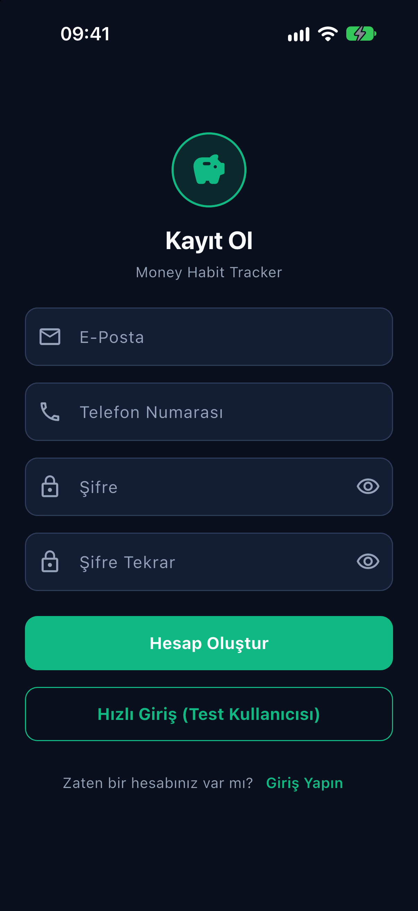

# Money Habit

Para yönetimini alışkanlığa dönüştürmek için 10 günlük finansal görevlerden oluşan challenge'ları, kişisel tasarruf hedeflerini, günlük harcama kaydını ve aylık bütçe takibini tek uygulamada birleştiren finansal alışkanlık takip uygulaması. Flutter ile yazılmıştır; tüm veriler cihazda (`shared_preferences`) saklanır, backend yoktur.

> Klasör adı `Money-Habit`, paketin adı `money_habit_tracker`, cihazda görünen ad **Money Habit**'tir.

| Ana Panel | 10 Günlük Challenge | Finansal Hedeflerim |
| --- | --- | --- |
|  |  |  |

| Harcamalar | Bütçe & İstatistik | Ayarlar |
| --- | --- | --- |
|  |  |  |

| Yeni Harcama | Hedef Detayı | Kayıt Ol |
| --- | --- | --- |
|  |  |  |

Ek görüntüler: [Giriş](docs/screenshots/02-login.png) · [Yeni hedef ekle](docs/screenshots/07-add-goal.png) · [Bütçe limiti belirle](docs/screenshots/11-set-budget.png) · [Aydınlık tema](docs/screenshots/13-dashboard-light.png) · [İngilizce](docs/screenshots/14-budget-en.png)

## Özellikler

- Kayıt / giriş (e-posta, `5XX XXX XX XX` maskeli telefon, en az 8 karakter + büyük/küçük harf + rakam içeren şifre; şifre SHA-256 özeti olarak saklanır), oturum açık kalır; tek dokunuşla test kullanıcısıyla hızlı giriş
- **Ana Panel:** bu ayki kalan bütçe, aktif challenge'ın bugünkü görevi ve seri sayısı, en yakın hedefin ilerlemesi ve son harcamalar; kartlara dokununca ilgili sekme açılır
- **10 Günlük Challenge:** hazır şablondan 10 finansal görev; yalnızca bugünün görevi tamamlanabilir (gelecek günler kilitli, kaçırılan gün "Kaçırıldı" olarak görünür), gün sayacı, güncel ve en iyi seri; challenge bitince tebrik ve yeniden başlatma
- **Finansal Hedeflerim:** hedef adı ve tutarıyla hedef ekleme, "Para Ekle" ile ilerleme adımları (tutar + opsiyonel not), yüzde ve ilerleme çubuğu, ilerleme geçmişi, hedefe ulaşınca "Tamamlandı" rozeti, hedef silme
- **Harcamalar:** tutar, kategori (Market & Gıda, Ulaşım, Faturalar, Eğlence, Sağlık, Eğitim, Diğer), tarih ve not ile kayıt; tarihe göre gruplanmış liste, renkli kategori etiketleri, ay filtresi, kaydırarak silme ve "Geri Al"
- **Bütçe & İstatistik:** aylık bütçe limiti belirleme, harcanan / kalan göstergesi (limit aşılınca uyarı rengi), kategori dağılımı halka grafiği ve son 7 gün çubuk grafiği (`CustomPainter` ile, harici grafik paketi yok)
- **Ayarlar:** hazır avatar veya galeriden / kameradan profil resmi, kullanıcı özeti, e-posta / telefon / şifre güncelleme (şifre değişiminde mevcut şifre doğrulanır), çıkış yap (veriler silinmez)
- Tutarlar kuruş (`int`) olarak saklanır, `₺` biçiminde gösterilir
- Koyu ("Gece Finans": lacivert & zümrüt / altın, varsayılan) ve aydınlık tema; Türkçe (varsayılan) / İngilizce, anında uygulanır ve kalıcı saklanır
- Uygulama ikonu (Android uyarlanabilir ikon dahil) ve koyu zeminli yerel açılış ekranı (Android 12+ dahil)
- İlk açılışta örnek veri: 5 harcama, 15.000 ₺ aylık bütçe, 2 hedef (Acil Durum Fonu, Yeni Dizüstü Bilgisayar) ve başlamış bir 10 günlük challenge

## Kurulum ve çalıştırma

```bash
flutter pub get
flutter gen-l10n
flutter analyze
flutter test
flutter run            # bağlı cihaz / emülatör
```

> Not: Uygulama Android emülatöründe, iOS simülatöründe ve gerçek cihazlarda çalışır. Ekran görüntüleri iOS simülatöründe (iPhone 18 Pro) alınmıştır. Hızlı giriş için test kullanıcısı: `demo@moneyhabit.com` / `Password123`. iOS en düşük sürümü 15.0'dır.

İkon veya açılış ekranı dosyaları değişirse:

```bash
dart run flutter_launcher_icons
dart run flutter_native_splash:create
```

## Mimari

Feature bazlı klasörler (`controllers/`, `models/`, `views/`, `widgets/`); state `ValueNotifier` + `ValueListenableBuilder`, navigasyon çekirdek `Navigator` + isimli rotalar (`core/router/app_router.dart`). Tüm depolama erişimi tek bir `LocalStorageService` üzerinden yapılır; harici state/DI/router paketi yoktur. Ayrıntılar: [PROJECT.md](PROJECT.md), [.agents/skills/](.agents/skills/). Geliştirme günlüğü ve kararlar: [DONE.md](DONE.md).

## Notlar

- Gerçek veritabanı yoktur; modeller JSON olarak `shared_preferences`'ta saklanır. İleride gerçek veritabanına geçişte yalnızca `LocalStorageService` değişir.
- Seçilen profil resmi uygulama klasörüne kopyalanır (web hariç).
- iOS'ta galeri/kamera izin metinleri `ios/Runner/Info.plist` içindedir.
