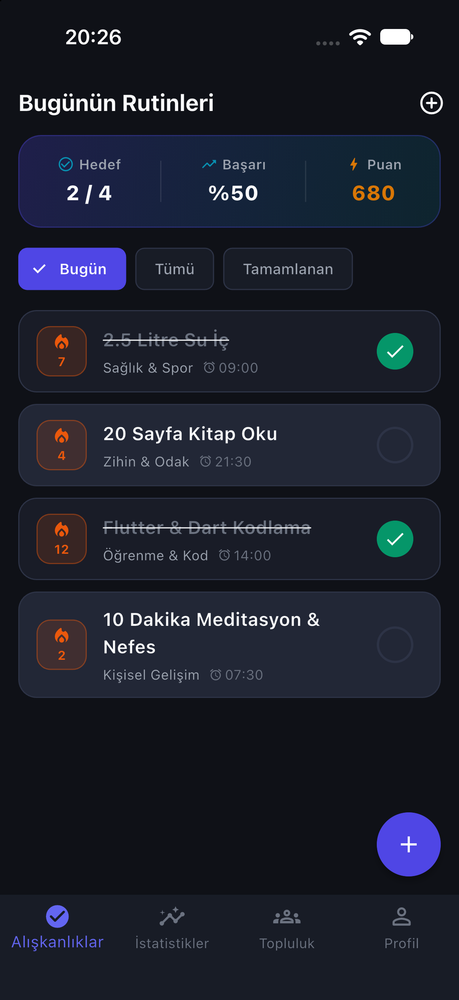
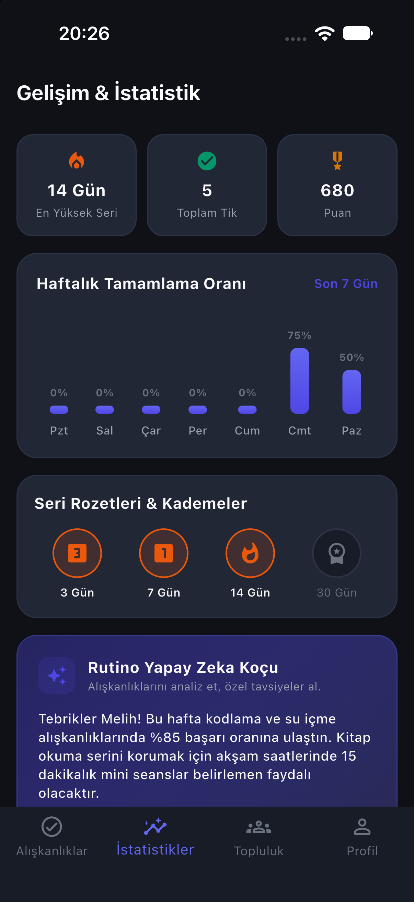
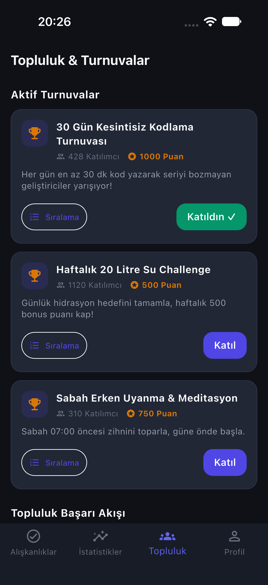
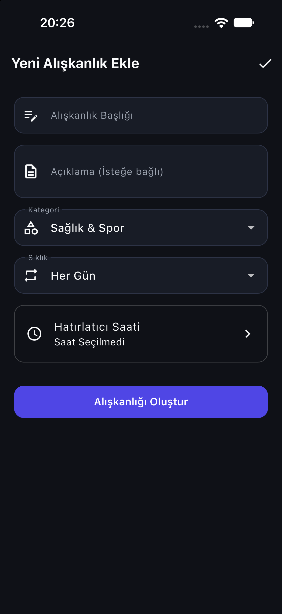
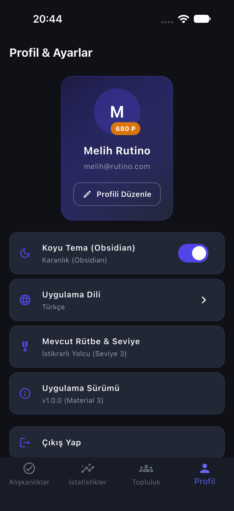
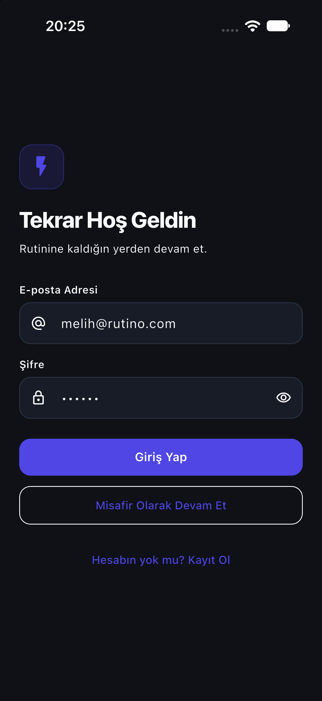

# Rutino

Günlük alışkanlıklarını takip ettiğin; seri (streak), puan ve seviye sistemiyle motive olduğun, yapay zeka koçundan kişisel tavsiye aldığın ve topluluk turnuvalarında yarıştığın bir alışkanlık takip uygulaması. Flutter ile yazılmıştır; tüm veriler cihazda (`shared_preferences`) saklanır, backend yoktur.

> Klasör adı `Rituno`, uygulamanın ve paketin adı `Rutino` / `rutino`'dur.

| Bugünün Rutinleri | İstatistikler | Topluluk & Turnuvalar |
| --- | --- | --- |
|  |  |  |

| Yeni Alışkanlık | Profil & Ayarlar | Giriş |
| --- | --- | --- |
|  |  |  |

Ek görüntüler: [Kayıt](docs/screenshots/02-register.png) · [Açık tema](docs/screenshots/08-habits-light.png) · [İngilizce](docs/screenshots/09-profile-en.png) · [AI Koç analizi (İngilizce)](docs/screenshots/10-ai-coach-en.png) · [Açılış ekranı](docs/screenshots/11-splash.png)

## Özellikler

- Kayıt / giriş (ad, e-posta, telefon, şifre validasyonları) ve misafir olarak giriş
- **Alışkanlıklar:** ekleme, düzenleme, silme; kategori (Sağlık & Spor, Zihin & Odak, Öğrenme & Kod, Kişisel Gelişim, Üretkenlik) ve sıklık (Her Gün, Hafta İçi, Hafta Sonu, Haftada 3 Gün) seçimi; Tümü / Bugün / Tamamlanan filtreleri ve günlük tamamlama özeti
- **Oyunlaştırma:** her tamamlamada 15 puan + seri bonusu (seri × 5); tamamlama geri alınınca puan geri düşer; toplam puana göre 5 seviyeli rütbe (Çaylak → Efsane Lider), seçili dilde gösterilir
- **İstatistikler:** özet kartları, haftalık başarı grafiği ve seri rozetleri (milestone)
- **AI Koç:** alışkanlık verilerine göre durum özeti ve kişisel öneriler üreten kart; analizler üretildikleri dille saklanır ve her dilde o dilin son analizi gösterilir
- **Topluluk:** turnuva kartları, turnuvaya katılma / ayrılma, liderlik tablosu ve topluluk akışı
- **Profil:** profil düzenleme, avatar, tema ve dil seçimi
- İndigo ilerleme halkası ve onay işaretinden oluşan uygulama ikonu (Android uyarlanabilir ve tek renkli ikon dahil) ve koyu zeminli yerel açılış ekranı (Android 12+ dahil)
- Koyu (varsayılan) ve açık tema; Türkçe (varsayılan) / İngilizce, uygulama yeniden başlatılmadan anında değişir
- İlk açılışta örnek alışkanlıklar (su içme, kitap okuma, kodlama, meditasyon), geçmiş seri verileri ve üç turnuva tohumlanır

## Kurulum ve çalıştırma

```bash
flutter pub get
flutter analyze
flutter test
flutter run            # bağlı cihaz / emülatör
```

> Not: Hedef platformlar Android ve iOS'tur; uygulama iOS simülatöründe (iPhone 18 Pro) çalıştırılarak denenmiştir.

İkon veya açılış ekranı dosyaları (`assets/icon/*.svg` → PNG) değişirse:

```bash
dart run flutter_launcher_icons
dart run flutter_native_splash:create
```

## Mimari

Feature bazlı klasörler (`auth`, `habits`, `statistics`, `community`, `profile`, `home`; her biri `controllers/`, `models/`, `views/`, `widgets/`). State yönetimi `ValueNotifier` + `ValueListenableBuilder` ile yapılır; harici state paketi yoktur. Ortak servisler `lib/core/services/` altındadır (`StorageService`, `AIService`, `NotificationService`). Metinler `AppStrings` içindeki TR/EN sözlükten gelir.

Ayrıntılar: [PROJECT.md](PROJECT.md), [AGENTS.md](AGENTS.md). Geliştirme günlüğü ve kararlar: [DONE.md](DONE.md).

## Testler

`test/` altında 18 test bulunur:

- `unit_test.dart`: model serileştirme, seri / puan hesabı, istatistik oranları
- `theme_test.dart`: açık / koyu tema renkleri, kontrast ve canlı tema geçişi
- `language_test.dart`: TR/EN sözlük, dil kalıcılığı, rütbenin seçili dilde gösterilmesi, AI Koç analizinin dile göre seçilmesi ve arayüzün anında İngilizceye dönmesi
- `widget_test.dart`: uygulama açılışı duman testi

## Notlar

- Kimlik doğrulama yereldir ve demo amaçlıdır: şifre saklanmaz ve girişte doğrulanmaz.
- AI Koç gerçek bir yapay zeka API'sine bağlı değildir; öneriler cihazda kural tabanlı olarak üretilir. Gemini / OpenAI entegrasyonu planlanmaktadır.
- Bildirim servisi şimdilik yer tutucudur (hatırlatıcılar yalnızca loglanır, telefon bildirimi gönderilmez).
