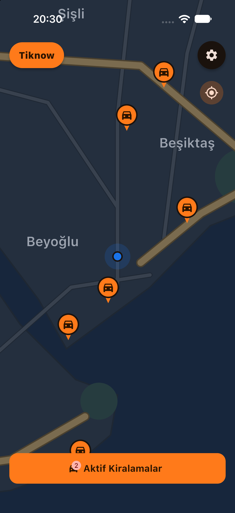
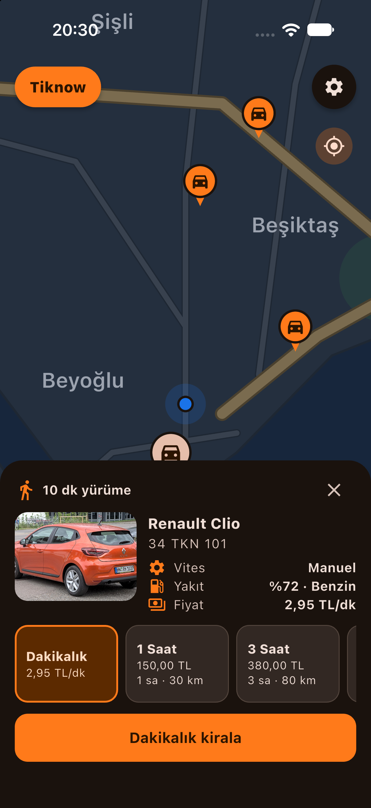
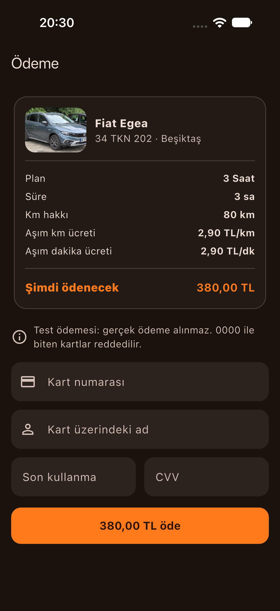
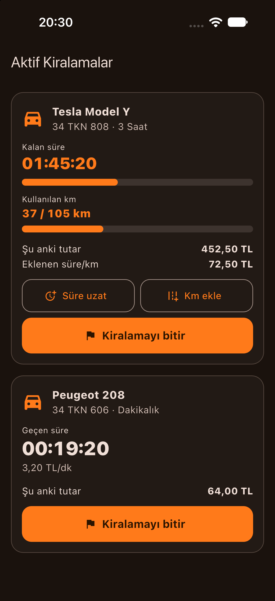
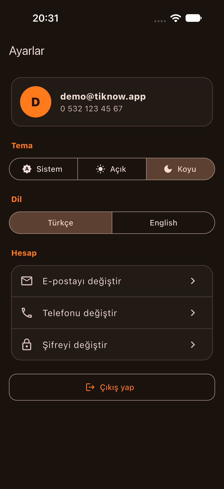
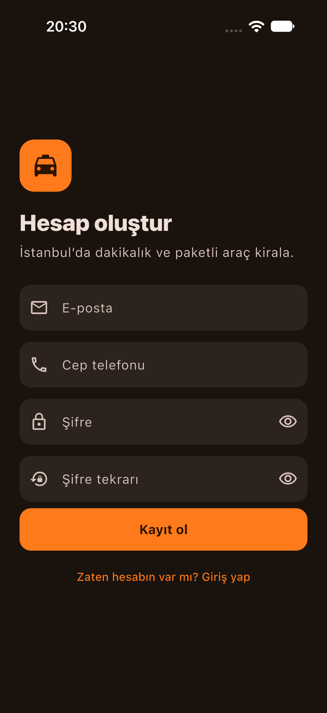

# Tiknow

İstanbul haritası üzerinden araç seçip **dakikalık** veya **paket** bazlı kiraladığın bir araç kiralama uygulaması. Flutter ile yazılmıştır; hesap, ayarlar ve aktif kiralamalar cihazda (`shared_preferences`) saklanır. Gerçek ödeme, GPS ve backend yoktur.

| İstanbul Haritası | Araç Paneli | Ödeme |
| --- | --- | --- |
|  |  |  |

| Aktif Kiralamalar | Ayarlar | Kayıt |
| --- | --- | --- |
|  |  |  |

Ek görüntüler: [Giriş](docs/screenshots/02-login.png) · [Aydınlık tema](docs/screenshots/08-map-light.png) · [İngilizce](docs/screenshots/09-vehicle-panel-en.png)

## Özellikler

- Kayıt / giriş (e-posta, `5XXXXXXXXX` / `05XXXXXXXXX` telefon, güçlü şifre: 8+ karakter, büyük / küçük harf, rakam); şifre SHA-256 + salt özeti olarak saklanır, oturum kalıcıdır
- **Harita:** `CustomPainter` ile çizilmiş İstanbul (kara, Boğaz, Haliç, Marmara, parklar, yollar, semt etiketleri); kaydırma / yakınlaştırma, konuma dönme. Farklı semtlerde 12 araç turuncu simgelerle gösterilir; kiralanan araç haritadan düşer
- **Araç paneli:** yürüme süresi (Haversine × 1,3 ÷ 80 m/dk, kullanıcı konumu Taksim'de sabit), gerçek araç fotoğrafı (Wikimedia Commons), model, plaka, vites, yakıt ve fiyat
- **Kiralama planları:** Dakikalık (ör. `2,95 TL/dk`) veya paket: 1 Saat / 30 km / 150 TL, 3 Saat / 80 km / 380 TL, Tam Gün / 250 km / 900 TL; paketlerde süre ve km aşım ücreti
- **Ödeme (test):** kart numarası, son kullanma tarihi ve CVV biçim kontrolü, otomatik biçimlendirme; `0000` ile biten kart reddedilir (hata akışını denemek için)
- **Aktif kiralamalar:** canlı sayaç, kalan süre / km çubukları, süre uzatma ve km ekleme (paketlerde), kiralamayı bitirince aşım ve ek ücretleri içeren özet
- **Ayarlar:** e-posta, telefon ve şifre değişikliği (eski şifre doğrulamasıyla), sistem / açık / koyu tema, Türkçe / İngilizce (anında değişir), çıkış
- Turuncu zemin üzerine beyaz araç + konum iğnesi uygulama ikonu (Android, iOS, Web, macOS)

## Kurulum ve çalıştırma

```bash
flutter pub get
flutter analyze
flutter test
flutter run            # bağlı cihaz / emülatör
```

> Not: Desteklenen platformlar Android, iOS, Web ve macOS'tur. Uygulama iOS simülatöründe (iPhone 18 Pro) çalıştırılarak denenmiştir.

İkon değişirse (`assets/icon/` dosyaları `tool/make_icon_test.dart` ile üretilir):

```bash
dart run flutter_launcher_icons
```

## Mimari

Feature bazlı klasörler (`auth`, `rental_map`, `rental_packages`, `payment`, `active_rentals`, `settings`; her biri `controllers/`, `models/`, `views/`, `widgets/`). State `ValueNotifier` + `ValueListenableBuilder` ile yönetilir; uygulama geneli controller'lar `AppDependencies` içinde `main.dart`'ta oluşturulup constructor ile aşağı verilir. Harici state / DI / l10n paketi yoktur; metinler `AppStrings` içindeki TR/EN haritalarından `context.tr('anahtar')` ile gelir. `shared_preferences` erişimi yalnızca `StorageService` üzerinden yapılır. Fiyat hesapları UI'sız saf fonksiyonlardır (`ActiveRentalModel`).

Ayrıntılar: [PROJECT.md](PROJECT.md), [.agents/skills/SKILL.md](.agents/skills/SKILL.md). Geliştirme günlüğü ve kararlar: [DONE.md](DONE.md).

## Testler

`test/` altında 46 test bulunur:

- `validators_test.dart`: e-posta, telefon, şifre, kart, SKT, CVV
- `utils_test.dart`: TL biçimi, yürüme süresi, süre biçimi, şifre özeti
- `pricing_test.dart`: dakikalık ve paket ücreti, süre / km aşımı, ekler, JSON gidiş-dönüş
- `controllers_test.dart`: ayar kalıcılığı, kayıt / giriş / çıkış, profil, ödeme, kiralama akışı, bozuk JSON
- `app_strings_test.dart`: TR/EN anahtar eşitliği ve yer tutucu uyumu
- `widget_test.dart`: kayıt akışı, dil değişimi, oturum kalıcılığı, ayarlar ve ödeme akışı

## Notlar

- Tek yerel hesap vardır; yeni kayıt mevcut hesabın üzerine yazar.
- Dakikalık kiralamada kullanılan km simüle edilir (geçen dakika × 0,5 km); ücret kiralama bitince hesaplanır, bu yüzden ödeme ekranında tutar 0,00 TL görünür.
- Araç fotoğrafları internetten yüklenir; yüklenemezse araç ikonu gösterilir.
- Windows / Linux desteği eklenmedi; gerçek cihazda henüz denenmedi.
